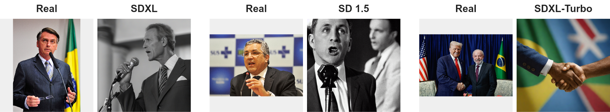
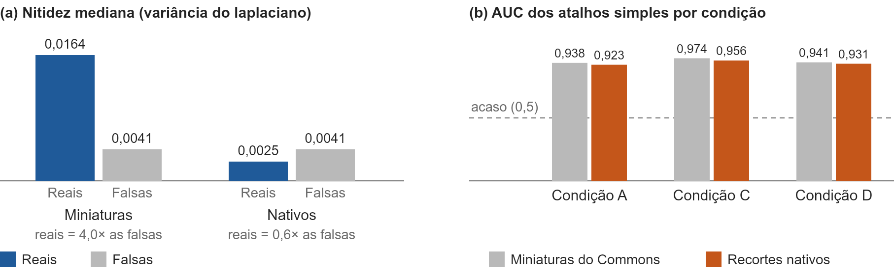
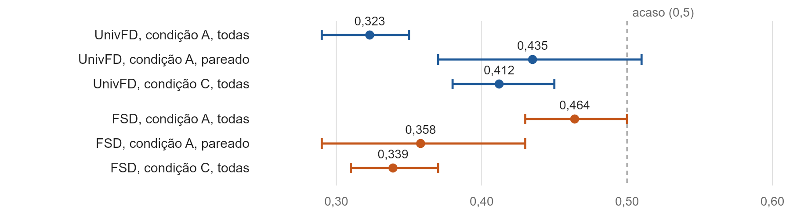

# Detecção de imagens geradas por IA em fotos políticas brasileiras

> **Trabalho de Conclusão de Curso (TCC)** · Área: **Aprendizado de Máquina / Visão Computacional** (deep learning aplicado a forense de imagens)
>
> Não é um aplicativo nem um site. É um projeto de pesquisa em **notebooks Python (Google Colab)**: avalia detectores de imagens geradas por IA já treinados (**UnivFD** e **FSD**) e investiga se os números que eles produzem são confiáveis.

## O que este projeto faz

Detectores de "imagem feita por IA" costumam mostrar bons resultados em bases de teste públicas. Este trabalho pergunta: **eles funcionam em fotos políticas brasileiras?** E, antes disso: **o resultado de um detector reflete a imagem ou atalhos escondidos no conjunto de teste** (formato do arquivo, tamanho, nitidez)?

Para responder, o projeto:

1. **Reanalisa** uma base pública (Tiny-GenImage) e descobre que, nela, todas as fotos reais eram JPEG e todas as falsas eram PNG.
2. **Constrói um conjunto brasileiro** de 1.027 imagens: 513 fotos reais de 50 políticos (Wikimedia Commons, licenças livres) e 514 imagens geradas por Stable Diffusion 1.5, SDXL e SDXL-Turbo, cada uma a partir da legenda de uma foto real (sem nomes, pessoas fictícias).
3. **Audita atalhos**: treina um classificador simples sobre 11 medidas triviais (tamanho do arquivo, nitidez, cor) para ver se ele separa reais de falsas sem nenhum detector.
4. **Avalia os detectores** com AUC e intervalo de confiança de 95%, no conjunto todo e em um subconjunto **pareado** por nitidez e tamanho (escore de propensão).
5. **Faz controles**: sem JPEG adicional, com dupla compressão nas falsas e com recortes **nativos** dos originais (sem a recompressão do Commons).

> **Importante:** o projeto **não treina um modelo novo**. Ele *avalia* modelos prontos e *audita* a base de teste. A contribuição é metodológica e empírica.

## O que quisemos fazer

- Saber se UnivFD e FSD discriminam real de gerado em fotos políticas brasileiras.
- Medir **quanto do desempenho aparente vem de propriedades do arquivo**, e não da imagem.
- Entregar um **conjunto reproduzível** (origem, licença, gerador, prompt e semente de cada imagem registrados) e um **protocolo de auditoria** que sirva para outros detectores.
- Deixar claro que detectar IA **não prova** que um conteúdo é falso ou enganoso: o resultado de um detector é uma pista, não um veredito.

## Resultados em uma olhada

- Mesmo depois de padronizar tamanho, recorte e compressão, **11 medidas simples separaram reais de falsas com AUC de 0,946**. Em todas as condições testadas, o AUC dos atalhos ficou entre 0,92 e 0,97.
- Com fotos reais **nativas** (recortes dos originais), a diferença de nitidez **se inverteu**: nas miniaturas do Commons as reais tinham 4,0× o detalhe das falsas; nos recortes nativos, 0,6×.
- **Nenhum detector discriminou real de gerada além do que nitidez e tamanho explicam**: o UnivFD ficou no acaso no subconjunto pareado e o FSD, no acaso ou abaixo dele.
- Isso **não** prova que os detectores falhem em geral (o FSD foi avaliado a 512 px, abaixo do tamanho padrão). Ver [Limitações](#limitações).

### Exemplos: foto real e imagem gerada

*Em cada par, a foto real inteira (esquerda) e uma imagem gerada (direita), uma por gerador (SDXL, SD 1.5, SDXL-Turbo). As pessoas das imagens geradas são fictícias. Fotos reais (Wikimedia Commons): Gustavo Lima/Câmara dos Deputados (CC BY 3.0), Elza Fiúza/ABr e Ricardo Stuckert/PR/Agência Brasil (CC BY 3.0 BR).*

### Os atalhos continuam separando as classes

### AUC dos detectores (0,5 = acaso)

## Stack e bibliotecas

**Tipo de projeto:** pesquisa em *machine learning* (avaliação de modelos de visão computacional) + análise estatística.

| Camada | O que foi usado |
|---|---|
| **Linguagem e ambiente** | Python 3, Jupyter notebooks, **Google Colab** (GPU NVIDIA T4; os notebooks também rodam em CPU, mais devagar) |
| **Deep learning** | PyTorch, torchvision |
| **Detectores avaliados** | **UnivFD** ([Universal Fake Detect](https://github.com/Yuheng-Li/UniversalFakeDetect), CLIP ViT-L/14 + camada linear) e **FSD** ([Forensic Self-Descriptions, CVPR 2025](https://github.com/ductai199x/Forensic-Self-Descriptions-CVPR25)) |
| **Geração das imagens falsas** | Hugging Face `diffusers`, `transformers`, `accelerate`, `safetensors`: Stable Diffusion 1.5, SDXL 1.0 base e SDXL-Turbo |
| **Legendas das fotos reais** | BLIP (`Salesforce/blip-image-captioning-large`) |
| **Dados e estatística** | NumPy, pandas, SciPy, scikit-learn (regressão logística, validação cruzada, AUC, pareamento por escore de propensão), reamostragem (bootstrap) para IC de 95% |
| **Imagens** | Pillow, pillow-heif, SciPy (`ndimage`) para medidas de nitidez |
| **Visualização** | Matplotlib |
| **Utilitários** | tqdm, ftfy, regex, click, `huggingface_hub` |
| **Coleta das fotos originais** | PowerShell + `curl` (script local que respeita o limite de requisições do Wikimedia Commons) |
| **Documentação e figuras** | Markdown, Word (`docx`), LaTeX (classe `abntex2`), Node.js (geração de figuras) |

**Versões dos detectores (para reprodução):** UnivFD no commit `030495aea3300a8b54c0ec37ec7fe1dd7e63c619`; FSD no commit `50f2eae06efdac2e5a33f407ca9a27a2295133ac` (v1.1.0). Sementes fixas: 42 (amostra do Tiny-GenImage), `1000 + i` (geração das falsas), 0 e 1 (pareamentos e reamostragens).

## Estrutura do repositório

| Arquivo | O que é |
|---|---|
| `tcc_detectores.ipynb` | Reanálise do Tiny-GenImage com UnivFD e FSD |
| `2_gerar_falsas.ipynb` | Legendas (BLIP) e geração das 514 imagens falsas |
| `3_avaliar_politico.ipynb` | Padronização, auditoria de atalhos e avaliação dos detectores (condições A e B) |
| `4_nativo_controle_positivo.ipynb` | Mesmo processo com recortes **nativos** (condições C, A e D) |
| `4b_controle_positivo_miniaturas.ipynb` | Versão do anterior com as miniaturas do Commons |
| `3b_gerar_real_nativo.py`, `3c_baixar_real_nativo_local.ps1` | Download dos originais do Commons e recorte 512×512 (a versão local é a que funcionou) |
| `resultados_rapidos_colab.py` | Análise rápida das métricas a partir de CSVs |
| `dataset/dataset_politicos_br.csv` | Planilha com origem, autor, licença e SHA-256 de cada foto real |
| `registro_dados_e_experimentos.md` | **Registro técnico completo**, com todos os números e a linha do tempo |
| `projeto_de_pesquisa.docx`, `latex/` | Projeto de pesquisa de 3 laudas (Word e LaTeX/abnTeX2) |
| `texto_resultados_e_conclusao*.md` | Rascunhos de resultados e conclusão |
| `docs/img/` | Figuras usadas neste README |

## Como reproduzir

As **imagens não estão no repositório** (as reais têm licenças próprias e as falsas ocupam espaço). O código espera esta estrutura no Google Drive: `MyDrive/tcc_politicos/` com `real_oficial.zip`, `fake_geradas/` e, para a etapa nativa, `real_nativo.zip`.

1. **Reais:** gere a lista a partir de `dataset/dataset_politicos_br.csv` (campo `fonte_url` aponta para a página de cada foto no Commons).
2. **Falsas:** rode `2_gerar_falsas.ipynb` (precisa de GPU; levou cerca de uma hora por gerador no SDXL).
3. **Avaliação:** rode `3_avaliar_politico.ipynb` e, depois, `4_nativo_controle_positivo.ipynb` (ou `4b_...`).
4. **Reais nativas:** rode `3c_baixar_real_nativo_local.ps1` no PowerShell e envie o `real_nativo.zip` ao Drive. O Wikimedia limita o download de originais (erro 429); o script espera o tempo pedido.
5. Cada notebook salva os resultados em CSV no Drive, e eles retomam de onde pararam se a sessão cair.

## Limitações

- Amostras pequenas (119 e 69 pares nos subconjuntos pareados): os intervalos de confiança são largos.
- O viés de processamento **não foi eliminado**: os atalhos separam as classes em todas as condições (AUC de 0,92 a 0,97).
- As reais das condições A, B e C são **miniaturas recodificadas** do Commons; as falsas são pixels nativos de difusão. Na condição nativa, o recorte de 512×512 cobre só uma parte da foto (cerca de 10% a 23% da largura nos exemplos medidos), enquanto as falsas são cenas inteiras; **essa diferença de enquadramento não foi testada isoladamente**.
- FSD avaliado a 512 px (padrão: 1024 px) e limiares fixos (UnivFD 0,5; FSD −2,0).
- Falsas só de modelos de difusão e com **pessoas fictícias**: não representam deepfakes de políticos reais.
- A identidade dos políticos vem do Commons e **não foi verificada pela imagem**.
- **Próximo passo:** rodar os detectores nas reais nativas (513 recortes já preparados) e identificar quais atributos ainda separam as classes.

## Ética, licenças e uso responsável

- As fotos reais vêm do **Wikimedia Commons** com licenças livres (CC BY, CC BY-SA, CC0 ou domínio público); **autor e licença de cada uma estão em `dataset/dataset_politicos_br.csv`** e devem ser creditados em qualquer reuso.
- As imagens geradas retratam **pessoas fictícias** (nenhum nome de político entrou nos prompts) e devem ser mantidas privadas, só para pesquisa.
- Um detector de IA **não prova** que uma imagem seja falsa ou enganosa, nem a ausência de detecção prova que o contexto seja verdadeiro. Use os resultados como pista.
- Os modelos e códigos de terceiros (UnivFD, FSD, BLIP, Stable Diffusion) têm licenças próprias.

## Autoria

- **Estudante:** [PREENCHER]
- **Orientação:** [PREENCHER]
- **Uso de IA:** um assistente de IA (Claude, da Anthropic) apoiou a escrita e a correção de erros do código, e a organização dos textos. Decisões, execuções, análises e interpretação dos resultados são da estudante.

## Como citar

[PREENCHER: nome da estudante, título, instituição, ano.]
